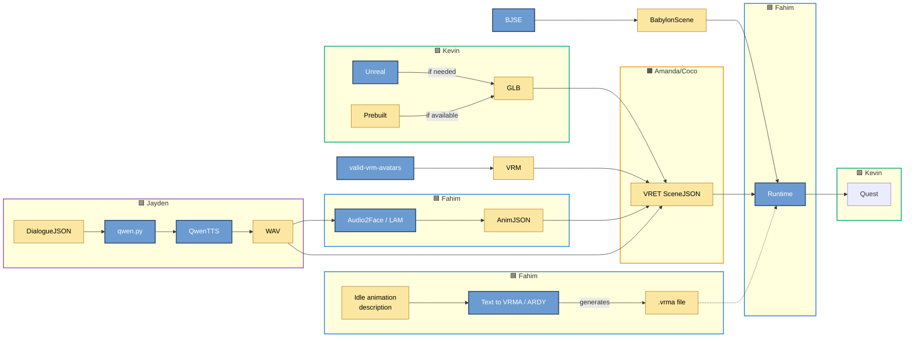
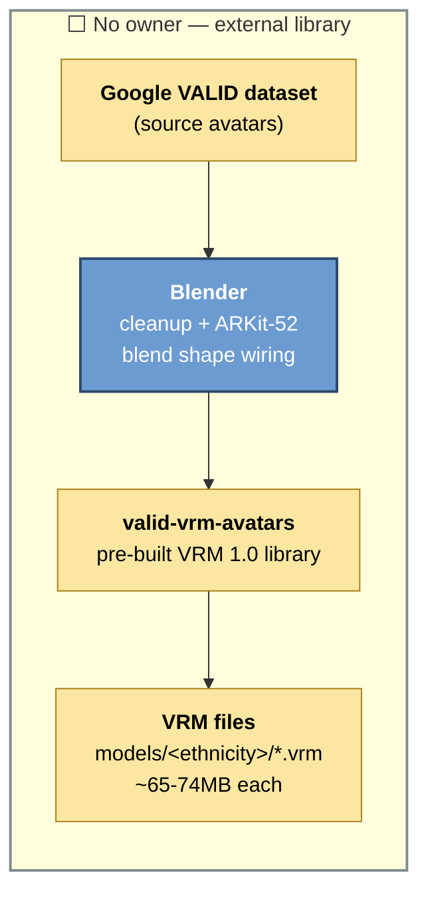
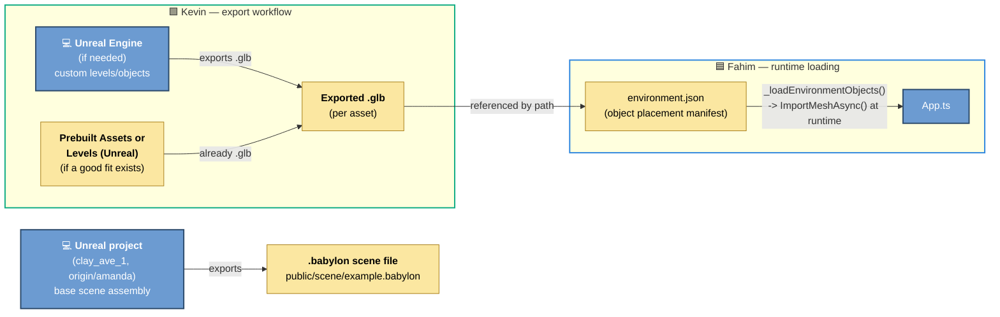
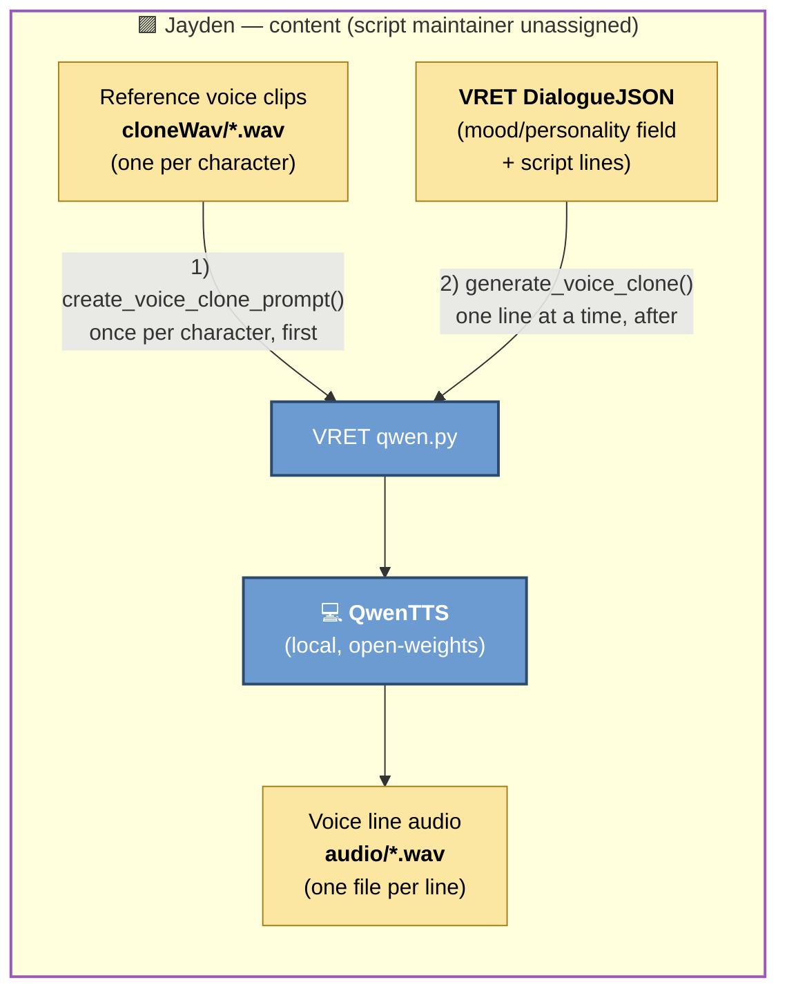
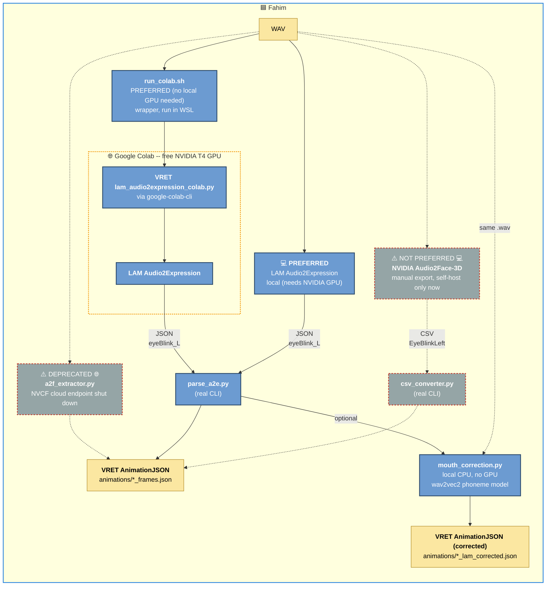
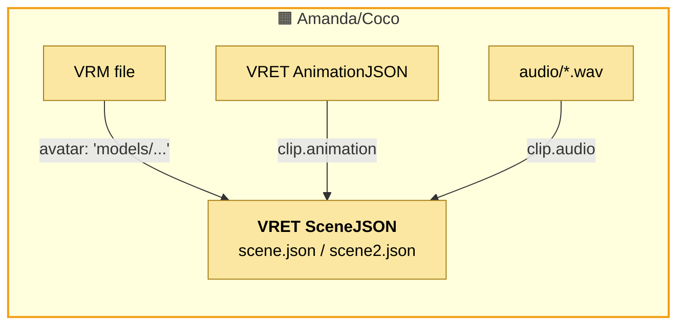
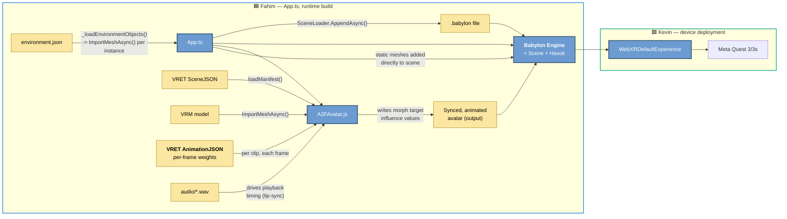
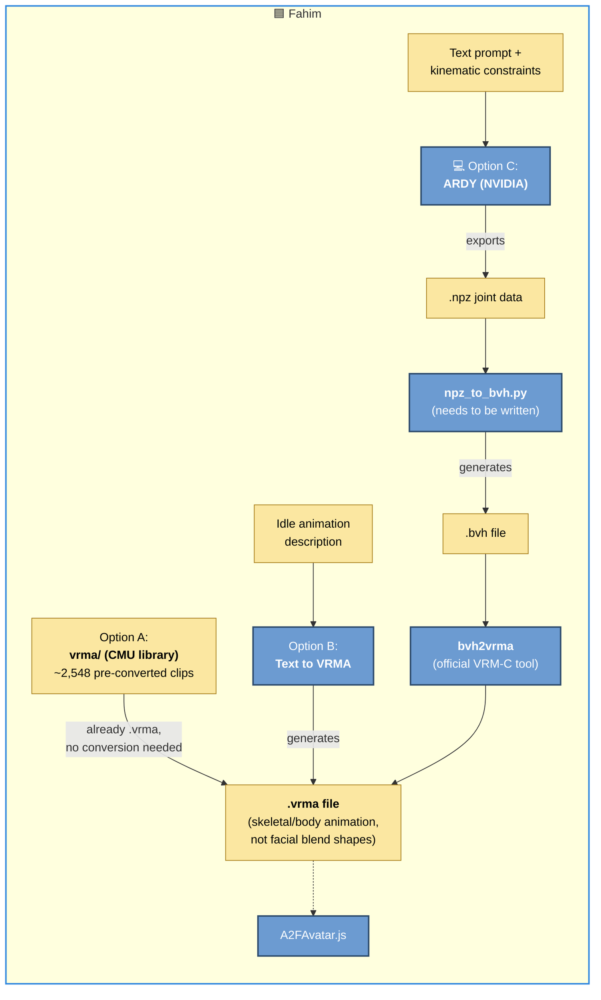

# VRET Tech Pipeline

Source-grounded in `babylon-clay-scene` (legacy `TLTMedia/VRET`, jungu + bennett branches) — every node below is either a tool/file I actually found in that project, or a file I watched it load at runtime.

Split into one small diagram per stage (instead of one giant flowchart) so each one actually fits the pane.

🔵 blue = software/program (actually does something) · 🟡 amber = data/file/artifact (gets produced or consumed)

🌐 = runs online/in the cloud (needs a live connection) · 💻 = runs offline/locally (no network dependency once set up) — marked on tool nodes where this is established; unmarked tools haven't been confirmed either way yet.

**Ownership boundaries:** thin colored boxes inside each diagram mark which nodes a specific person owns — 🟦 Fahim · 🟩 Kevin · 🟪 Jayden · 🟧 Amanda/Coco · ⬜ no owner (external). Nodes outside any colored box have no single assigned owner.

## Overview

- No owner (⬜) is implicit: `Library`, `VRM`, `BJSE`, `BabylonScene` sit outside every colored box.
- Kevin and Fahim each appear in more than one box — they own several disconnected parts of this flow, not one contiguous chunk.
- `QwenTTS` mechanics (voice cloning, local vs. hosted): Stage 3, `docs/QWENTTS.md`.

---

## 1. Character creation

⬜ **Owner:** no dedicated owner — sourced entirely from the existing valid-vrm-avatars library, not custom-built. Amanda/Coco reference it in their schema documentation.

- Avatars come from [valid-vrm-avatars](https://github.com/TLTMedia/valid-vrm-avatars): VRM 1.0 conversions of Google/UCF's VALID avatars, not built per-character.
- ARKit-52 blend shapes added on top via a Blender cleanup pass (`cleanFace.md`).
- Naming: `{Ethnicity}_{Sex}_{BodyType}_{Outfit}.vrm` (e.g. `Black_F_1_Casual.vrm`).
- Both avatars in the running demo come from this library.
- The legacy repo's `models/` folder is a superset — also has a `MetaHuman/` folder, named individual characters, and environment props outside this library.
- Full writeup (license, pros/cons): `docs/EXISTING_MODELS.md`.
- VRM files are served from `babylon-clay-scene/public/models/`, directly by Vite in both dev and production.

## 2. Environment authoring

🟩 **Owner:** Kevin (export workflow) · 🟦 Fahim (runtime loading)

- Unreal is conditional, not mandatory — only for custom levels/objects when nothing suitable already exists.
- "Prebuilt" = either prebuilt assets (individual objects) or prebuilt levels (whole environments) — used directly instead of custom authoring when a good fit exists.
- Either path produces a `.glb` per asset. `BJSE` has no single assigned owner.
- **Decided and built (10/29):** `.glb` assets are referenced by path in a dedicated **`environment.json`** manifest — not `VRET SceneJSON` as originally planned, see Stage 5 — and loaded individually at runtime (`App._loadEnvironmentObjects()` calling `_loadGlbAsset()` calling `ImportMeshAsync` in `App.ts`), not pre-combined into `.babylon` via the Editor. Objects are grouped by asset path with an `instances` array (position/rotation/scaling per placement) so repeated props don't repeat the asset path. Tested end-to-end with a temp police-car asset; not yet reviewed by Kevin/Amanda/Coco (VRE-107) and no visual placement tool exists yet (coordinates are hand-typed). Full schema writeup in `babylon-clay-scene/ANIMATION_PIPELINE.md` §2b.
- **BJSE vs. the Babylon Engine:** historically, BJSE (Babylon.js Editor) was meant to assemble the base scene (lights, camera, environment, static geometry) and export a static `.babylon` file, with no role at runtime. **Update (11/1):** the actual recovered editable source for the base scene is a full **Unreal Engine project** (`clay_ave_1`, on the `origin/amanda` git branch), not a BJSE project — Unreal is now the de facto scene-authoring tool for the base environment too, feeding the same `.glb` export path described above. BJSE itself is effectively moot going forward. The Babylon Engine remains the runtime library bundled into the deployed app, reading `.babylon` + `.glb`/VRM files live in the browser; `environment.json`'s assets load into it at runtime, never pre-combined via an editor.
- Tradeoff: N separate `.glb` loads cost more than one pre-combined file (more round-trips, more draw calls). Mitigate with parallel loading (`Promise.all`, not sequential), Draco/KTX2 compression, and modest poly/texture budgets — this ships to standalone Quest hardware.

## 3. Voice generation

🟪 **Owner:** Jayden (script/dialogue content, mood/personality direction). The calling script itself (`qwen.py`) has no assigned maintainer yet, and currently sits untracked in `temp/qwenTTS/`, pulled from the old repo's `jayden`/`paul` branches — not yet part of the tracked pipeline.

- `qwen.py` reads `VRET DialogueJSON` (mood/personality field at the top) and calls QwenTTS **one dialogue line at a time**, not the whole script in one pass.
- Before generating any lines, it builds a cloned voice per character from a reference clip + transcript — a one-time step, reused for every line that character speaks.
- Output: one `.wav` per line.
- Local, open-weights, free — needs a GPU for reasonable speed (`qwen.py` currently runs on CPU instead). Alibaba also hosts it as a paid cloud API, unused here.
- Full mechanics, file breakdown, open questions: `docs/QWENTTS.md`.
- A separate, undocumented WAV-combining script (tied to the facial-animation/audio sync investigation) stitches per-line clips together downstream — see Open Questions.

## 4. Facial animation — choose ONE option per clip

🟦 **Owner:** Fahim (sync pipeline, converters).

- **LAM Audio2Expression is the preferred path (decided 2026-10-22).** NVIDIA Audio2Face-3D's hosted cloud endpoint — its one real advantage, avoiding local GPU use — is deprecated, so both tools now equally require a GPU; LAM is free either way, Audio2Face-3D self-hosted likely isn't. See `docs/AUDIO2FACE_VS_AUDIO2EXPRESSION.md` for the full comparison.
- **Build process changed (11/10): Colab is now driven headlessly via the CLI, not a notebook you click through by hand — confirmed working end-to-end.** `lam_audio2expression_colab.py` (`babylon-clay-scene/animations/`, mirrored in `team/fahim/audio2expression/`) runs LAM on a free Google Colab NVIDIA T4 GPU for machines without one locally — same steps as before (own Python 3.10 venv, deps via pip, weight download, inference), invoked via Google's official `google-colab-cli` (`colab new` → `colab upload` → `colab exec -f` → `colab download` → `colab stop`), run from WSL2 since the CLI is Linux/macOS only. `team/fahim/audio2expression/run_colab.sh` wraps that whole sequence into one command that only needs the audio file(s) (or a folder of them) as input — it stops the GPU session after every run by default to protect free-tier compute-unit quota, pass `--keep` if about to run another batch right away. Setup is scripted too: `setup_windows.ps1` (enables WSL2, installs Ubuntu) and `setup_wsl.sh` (installs the venv, CLI, and `keyrings.alt` — required, or the OAuth token won't persist); the actual Google login still has to be done by hand once. The original `LAM_Audio2Expression_Colab.ipynb` still exists as a manual fallback/reference. Full step-by-step in `ANIMATION_PIPELINE.md` §6. First real run (`altaforte.wav`) produced output matching known-good ranges from prior manual LAM runs.
- `parse_a2e.py` (LAM path): now has a real CLI (`-o`, `--quiet`), not hardcoded filenames.
- **New optional post-process step (11/12): `mouth_correction.py`.** It runs locally on CPU, so no Colab or GPU is needed. It takes the converted LAM JSON plus the same `.wav`, recognizes phonemes from the audio itself with a wav2vec2 phoneme model (no transcript), and sharpens shapes LAM under-articulates: M/B/P lip closure, jaw drop on open vowels, rounding on W/OO, and lower lip held up on F/V/S/SH. Output is a separate `*_lam_corrected.json`, so the uncorrected file stays for A/B. Tested on `altaforte` only so far. TH/L/T/D/N/K/G aren't corrected because the avatars have no tongue mesh. Setup and flags: `ANIMATION_PIPELINE.md` §6b; per-class table: `docs/FACIAL_ANIM_REGEN_NOTES.md`.
- **Audio2Face-3D is explicitly not preferred going forward** — `a2f_extractor.py` (direct gRPC) is fully deprecated since its NVCF cloud endpoint is shut down; manual CSV export + `csv_converter.py` still technically works but requires self-hosting Audio2Face-3D, which needs the same GPU LAM needs anyway, for a tool that's likely not free. Kept in the repo and documented only in case self-hosted Audio2Face-3D becomes worth revisiting later.
- All 4 of this demo's current clips went through Audio2Face → CSV (manual export, predates `a2f_extractor.py`, confirmed via git history — see `docs/FACIAL_ANIM_REGEN_NOTES.md`), with every Audio2Face parameter on them unknown/untuned. LAM was only spot-tested on one clip before this decision.

## 5. Scene manifest (hand-authored)

🟧 **Owner:** Amanda/Coco (schema documentation, future automation).

- `VRET SceneJSON` (`scene.json`/`scene2.json`) is the per-character manifest: which VRM to load, idle/breathing params, and an ordered list of clips pairing one animation JSON with one audio WAV.
- Environment/object `.glb` references do **not** live here — they're in a separate `environment.json` manifest instead (Stage 2), loaded independently by `App.ts`.

## 6. Runtime

🟦 **Owner:** Fahim (`App.ts`, runtime build) · 🟩 Kevin (device deployment).

- `App.ts` boots the Babylon Engine, loads the base `.babylon` environment, loads environment/object `.glb` assets via `environment.json` (Stage 2), then creates one `A2FAvatar` per character.
- `A2FAvatar` is the pipeline's actual end consumer, not another conversion step. Inputs: VRM model, scene manifest, per-clip animation JSON, clip audio WAV. Output: a live, synced avatar — morph-target weights applied every render frame, timed to `audio.currentTime` so lip-sync holds even if a frame renders late.
- WebXR ships that to the Meta Quest 3/3s, the confirmed deployment target.
- BJSE vs. Babylon Engine: see Stage 2.
- GitHub (SBU-VRET/VRET-Project) is the storage/versioning layer underneath every stage above.

## 7. Idle/body animation (VRMA) — choose ONE option

🟦 **Owner:** Fahim (idle-animation integration, research).

- VRMA animates the avatar's *skeleton* (bones like `hips`, `spine`), not the face — separate track from Stage 4/6's facial blend shapes.
- `A2FAvatar.applyVRMA(vrmaPath)` loads and retargets a `.vrma` onto the avatar's bones — not called by either current demo character.
- **Option A — reuse what's already there.** The old repo's `vrma/` has ~2,548 CMU-derived `.vrma` clips, already converted, no extra step needed. Full writeup: `docs/EXISTING_MODELS.md`.
- **Option B — [Text to VRMA](https://github.com/Kirakun0328/text-to-vrma).** Outputs `.vrma` directly, no extra conversion.
- **Option C — [ARDY](https://github.com/nv-tlabs/ardy)** (NVIDIA + ETH Zürich). Generates new motion from a text prompt, outputs `.npz`. Needs a `npz_to_bvh.py` script (not written) to reach `.bvh`, then **[bvh2vrma](https://github.com/vrm-c/bvh2vrma)** (official VRM-C tool) to reach `.vrma`. Needs local GPU inference (RTX 4090 recommended).

## Open questions / TODO
- [ ] **Document the WAV-combining step.** The script that stitches multiple per-line WAV files into one combined audio file (built with Gemini's help) still isn't documented — likely tied to the facial-animation/audio sync gap Fahim's diagnosing. Distinct from `qwen.py` (Stage 3), which is now documented in `docs/QWENTTS.md`.
- [ ] **Does the base scene even need a `.babylon` file? (10/16 meeting)** Raised but not decided: load everything as `.glb` directly, skip BJSE/`.babylon` for the base scene too. Babylon.js stays the engine either way — confirm this still meets the project's scene requirements before changing anything. **Update (11/1): the BJSE-source-project question is resolved, but this one isn't.** The recovered source (see Stage 2) is a full Unreal project, not a BJSE project, and it's still only on the `origin/amanda` branch, not merged into the active build — so the base scene is still shipping as `example.babylon` for now. Whether to keep exporting through `.babylon` at all, vs. moving the base environment to the same per-asset `.glb` + `environment.json` path used for props, is still open.
- [ ] **Materials/textures rendering cost across `.glb` assets (10/16 meeting).** Separate from the per-asset-loading tradeoff already noted in Stage 2 — specifically about how many distinct materials/textures the scene ends up with. Investigate optimization opportunities.
- [ ] Clarify whether Unreal's export also needs to carry behavior-tree/Smart Object data (Kevin's Spring task), or whether that's a separate pipeline from the background/geometry export
- [ ] **Pick an idle-animation source** — reuse the CMU `vrma/` library, Text to VRMA, or ARDY (research done — see Stage 7 above) — and wire `applyVRMA()` into `App.ts` for at least one character
- [ ] Check whether the team has access to an RTX 4090 (or equivalent) if ARDY is the chosen path — it's a local-inference research model, not a lightweight tool
- [ ] `qwen.py` (Stage 3) needs a maintainer and a real home in the tracked repo — currently sitting untracked in `temp/qwenTTS/`. See `docs/QWENTTS.md` for the rest of its open questions (CPU vs. GPU, matching it to the WAV-combining script above).
- [ ] **When does player interactivity start, relative to the opening cutscene? (11/6 meeting)** Kevin proposed an opening cutscene — the car driving, then getting pulled over by the police car — to build context before the exposure scene proper, per Professor Ete's request that the player not just be dropped in without framing (treated as a high priority). Not decided: whether the player has any interactive control (e.g. driving) during the lead-in, or whether it's all non-interactive until the pull-over moment. Needs input from Kevin (VR interaction), Jayden (scene/script design), and Fahim (runtime/camera implementation).
- [ ] **Lean the threat NPC's expressions negative? (11/6 meeting)** Jayden's research found people dwell more on angry/upset/annoyed faces than neutral or positive ones — raised as a possible direction for the officer/threat character's facial animation. Not yet decided or scoped against the current LAM-generated expression pipeline.
