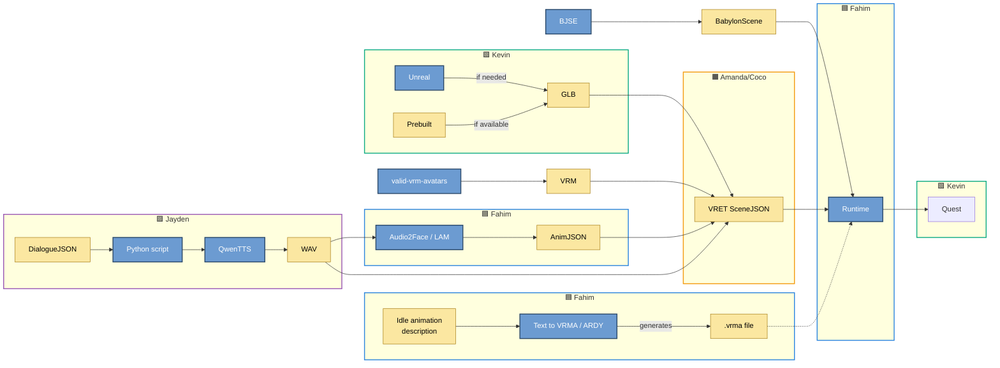
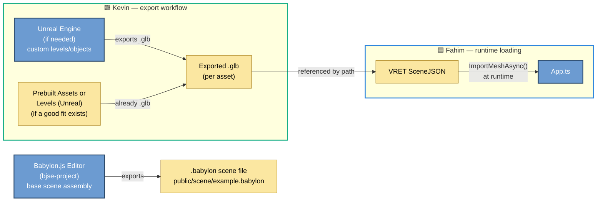
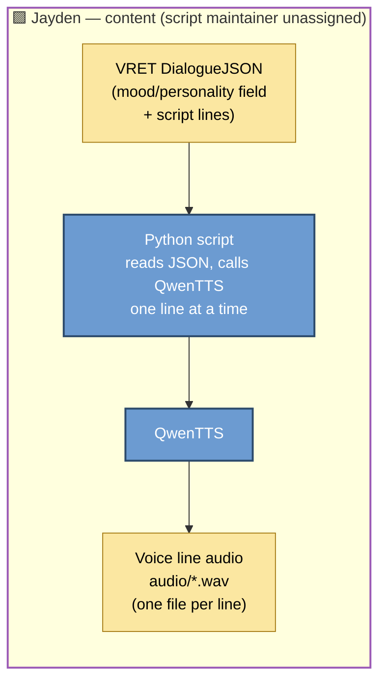
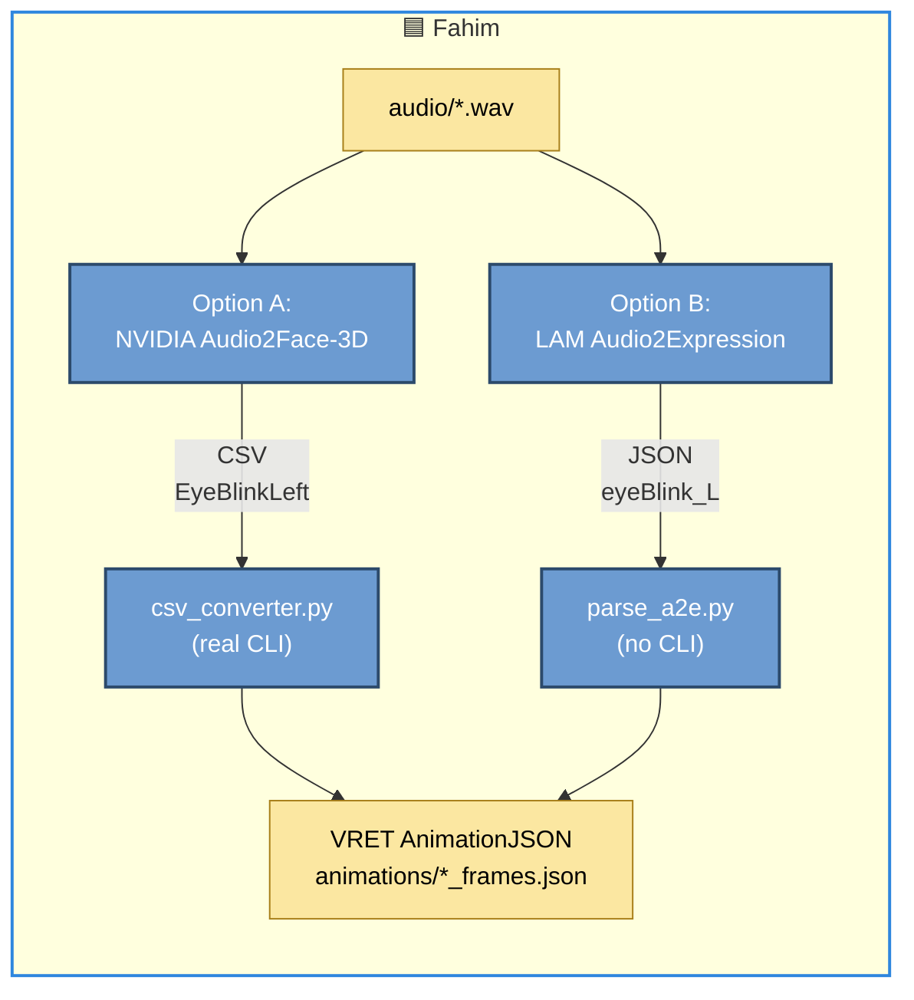
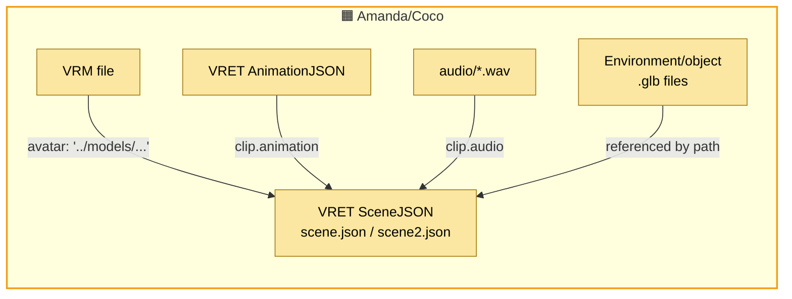
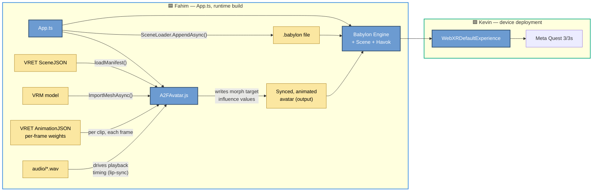
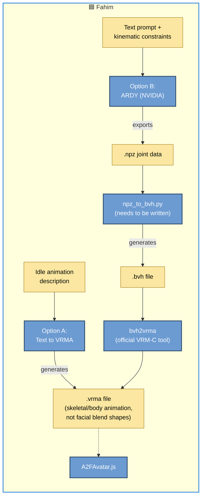

# VRET Tech Pipeline

Source-grounded in `babylon-clay-scene` (legacy `TLTMedia/VRET`, jungu + bennett branches) — every node below is either a tool/file I actually found in that project, or a file I watched it load at runtime.

Split into one small diagram per stage (instead of one giant flowchart) so each one actually fits the pane.

🔵 blue = software/program (actually does something) · 🟡 amber = data/file/artifact (gets produced or consumed)

**Ownership boundaries (per the 10/2 meeting):** thin colored boxes inside each diagram mark which nodes a specific person owns — 🟦 Fahim · 🟩 Kevin · 🟪 Jayden · 🟧 Amanda/Coco · ⬜ no owner (external). Nodes outside any colored box have no single assigned owner.

## Overview

*(No owner — ⬜ — is shown implicitly: `Library`, `VRM`, `BJSE`, and `BabylonScene` sit outside every colored box. Kevin and Fahim each appear in more than one box since they own several disconnected parts of this flow, not one contiguous chunk.)*

---

## 1. Character creation

⬜ **Owner:** no dedicated owner — sourced entirely from the existing valid-vrm-avatars library, not custom-built. Amanda/Coco reference it in their schema documentation.

The character avatars are pulled from [valid-vrm-avatars](https://github.com/TLTMedia/valid-vrm-avatars), a pre-built library — not built from scratch per-character. It's VRM 1.0 conversions of Google Research's VALID (Visually Aligned Inclusive Dataset) avatars, extended with ARKit-52 blend shapes (TLTMedia's `cleanFace.md` documents the Blender cleanup process used to wire them). Files are organized by ethnicity, then named `{Ethnicity}_{Sex}_{BodyType}_{Outfit}.vrm` (e.g. `Black_F_1_Casual.vrm`). Both avatars in the running demo come from this library, not custom builds. The `models/` folder in the legacy repo is a superset of this library — it also has non-ethnicity content (a `MetaHuman/` folder, named individual characters, environment props) that falls outside what this library covers.

These VRM files sit as a **sibling** of `babylon-clay-scene/`, not inside it — a custom Vite dev-server plugin in `vite.config.ts` reaches up one directory to serve `/models/...` and `/vrma/...` at request time.

**This breaks on static hosting.** Kevin got a working demo live on GitHub Pages ([kevexperiences.github.io/PersonalScene](https://kevexperiences.github.io/PersonalScene/)) and had to move `models/` *inside* `babylon-clay-scene/` and make every scene/avatar/animation path local to the project folder — there's no dev server on GitHub Pages to run the sibling-folder middleware trick. The team's actual repo still has `models/` as a sibling at the root, so this needs to be part of Fahim's repo structure plan, not just Kevin's personal deployment.

## 2. Environment authoring

🟩 **Owner:** Kevin (export workflow) · 🟦 Fahim (runtime loading)

Unreal is **conditional, not mandatory** — it's for building custom levels/objects when nothing suitable already exists. "Prebuilt" covers two different things worth keeping distinct (per 10/2 meeting): **prebuilt assets** (individual purchased/free objects) or **prebuilt levels** (whole pre-made Unreal environments) — either way, if a good enough fit exists online, that gets used directly instead of custom Unreal authoring. Either path produces a `.glb` per asset (environment or individual object). The `BJSE` base-scene-assembly node has no single assigned owner — it's outside both colored boxes above.

**Decided: these `.glb` assets are referenced by path in `VRET SceneJSON` and loaded directly at runtime (`App.ts`), not pre-combined into the `.babylon` file via the Editor.** `App.ts` already imports `@babylonjs/loaders/glTF`, so the runtime can load `.glb`/`.gltf` natively. This was chosen over pre-combining because scenes change as a whole (not just the background), and the team wants future asset-level manipulation — picking which objects go into a given scene — which needs each asset swappable independently rather than baked into one static file. The Babylon.js Editor still handles base scene assembly (the existing demo's `.babylon` file), separately from this per-asset runtime loading. This handoff isn't built yet — see Open Questions. **Note:** the 10/2 meeting also raised a somewhat different framing of how SceneJSON/BJSE/the Babylon Engine relate — see Stage 6, still being reconciled.

**Tradeoff to watch:** loading N separate `.glb` files costs more than one pre-combined file — more network round-trips, more per-asset parse overhead, and more draw calls at render time (a combined file is typically mesh-merged by the Editor; separately-loaded assets aren't, unless done explicitly). Worth mitigating with parallel loading (`Promise.all` over the `ImportMeshAsync` calls, not sequential), Draco/KTX2-compressed exports, and modest per-object poly/texture budgets — especially since this ships to standalone Quest hardware, not desktop.

## 3. Voice generation

🟪 **Owner:** Jayden (script/dialogue content, mood/personality direction). The Python calling script itself has no assigned maintainer yet.

QwenTTS doesn't take the raw script directly (per 10/2 meeting clarification) — a Python script reads a `VRET DialogueJSON` file (the mood/personality descriptor for the line sits at the top of the JSON) and calls QwenTTS to generate audio **one dialogue piece at a time**, not the whole script in a single pass. Output is one `.wav` per line, generated offline.

A separate script — still being investigated by Fahim, tied to the facial-animation/audio sync gap — combines multiple per-line WAV files into one combined audio file downstream of this. Not yet documented here; see Open Questions.

## 4. Facial animation — choose ONE option per clip

🟦 **Owner:** Fahim (sync pipeline, converters).

Both tools take the same `.wav` audio and independently generate facial blend-shape animation — they're alternatives, not a chain, with different output formats/naming conventions each normalized by its own converter into the same schema (`fps`, `frameCount`, `blendShapeNames`, `frames`). `csv_converter.py` is the more finished of the two (real CLI, reads shape names from the CSV header); `parse_a2e.py` has the 52 names hardcoded and no CLI. All 4 of this demo's clips went through the **Audio2Face → CSV** path; LAM was only spot-tested on one clip.

## 5. Scene manifest (hand-authored)

🟧 **Owner:** Amanda/Coco (schema documentation, future automation).

`VRET SceneJSON` (`scene.json`/`scene2.json`) ties everything together per character: which VRM to load, idle/breathing parameters, and an ordered list of clips pairing one animation JSON with one audio WAV. It's also where environment/object `.glb` assets get referenced by path (see Stage 2) — not yet implemented, but this is the intended location so individual assets can be picked per scene.

## 6. Runtime

🟦 **Owner:** Fahim (`App.ts`, runtime build) · 🟩 Kevin (device deployment).

`App.ts` boots the Babylon engine, loads the base `.babylon` environment, then creates an `A2FAvatar` per character. `A2FAvatar` is the pipeline's actual end consumer, not another conversion step — its real inputs are the VRM model, the scene manifest, the per-clip animation JSON, and the clip's audio WAV; its output is a live, synced, animated avatar (morph-target weights applied every render frame, timed to `audio.currentTime` so lip-sync holds even if a frame renders late) that becomes part of the scene the Engine renders. WebXR ships that to the Meta Quest 3/3s, the confirmed deployment target.

**Per the 10/2 meeting:** `VRET SceneJSON` feeds into BJSE as part of runtime compilation, and at runtime it's the Babylon Engine itself that's actually running. The precise distinction between what BJSE does vs. what the Babylon Engine does — and exactly how each relates to this demo — is still being worked out (Fahim is looking further into this). This is a slightly different framing than Stage 2's current documented understanding (BJSE as a build-time-only editor producing the `.babylon` file, with GLB assets loaded separately at runtime by `App.ts`/Babylon Engine) — the two need to be reconciled once Fahim's investigation lands. Don't treat either framing as settled yet.

**GitHub** (SBU-VRET/VRET-Project) is the storage/versioning layer underneath every stage above.

## 7. Idle/body animation (VRMA) — choose ONE option

🟦 **Owner:** Fahim (idle-animation integration, research).

A separate animation track from Stage 4/6 — VRMA drives the avatar's *skeleton* (bones like `hips`, `spine`, retargeted by name), not the face. It covers idle poses/gestures/movement, where the Audio2Face/LAM pipeline only ever touches facial blend shapes. `A2FAvatar.applyVRMA(vrmaPath)` loads a `.vrma` file and retargets its animation tracks onto the avatar's bones, but neither demo character's `App.ts` setup calls it.

**Option A — [Text to VRMA](https://github.com/Kirakun0328/text-to-vrma).** Outputs `.vrma` directly — consumable by `applyVRMA()` with no extra conversion step.

**Option B — [ARDY](https://github.com/nv-tlabs/ardy)** (NVIDIA + ETH Zürich, SIGGRAPH 2026). A diffusion model that generates new motion in real-time from a text prompt plus optional kinematic constraints (root path/waypoints, keyframes, sparse joint positions) — it synthesizes motion, it doesn't select from a preset library. Output is `.npz` (world-space joint positions, local/global rotations, root position, foot contacts) across three skeleton options (a generic "Core" humanoid, Unitree G1 robot, or SOMA body model — "coming soon"). No VRM/VRMA export directly, but a usable path exists: **[bvh2vrma](https://github.com/vrm-c/bvh2vrma)** — the official VRM Consortium tool for converting BVH motion capture into VRMA — covers the second half of the job. That leaves one real gap: a small `npz_to_bvh.py` script to turn ARDY's joint data into BVH, which `bvh2vrma` can then convert to `.vrma`. Comparable in scope to `csv_converter.py`/`parse_a2e.py` in Stage 4, not a from-scratch VRMA/glTF exporter. Also requires local GPU inference for ARDY itself (Python 3.10+, PyTorch 2.4+, CUDA, RTX 4090 recommended).

## Open questions / TODO
- [ ] **Document the WAV-combining step.** The script that stitches multiple per-line WAV files into one combined audio file (built with Gemini's help) still isn't documented — likely tied to the facial-animation/audio sync gap Fahim's diagnosing. Distinct from the QwenTTS-calling script in Stage 3, which is now documented.
- [ ] **Reconcile the BJSE vs. Babylon Engine framing.** Stage 2 treats BJSE as a build-time-only editor; the 10/2 meeting suggested `VRET SceneJSON` feeds into BJSE as part of *runtime* compilation. Fahim is looking further into this to determine the actual distinction and reconcile Stage 2 and Stage 6.
- [ ] **Build runtime `.glb` loading in `App.ts`.** Decided: environment/object assets load individually at runtime (not pre-combined into `.babylon` via the Editor), referenced by path in `VRET SceneJSON` — see Stage 2. Not implemented yet.
- [ ] Clarify whether Unreal's export also needs to carry behavior-tree/Smart Object data (Kevin's Spring task), or whether that's a separate pipeline from the background/geometry export
- [ ] **Pick Text to VRMA or ARDY** as the idle-animation source (research done — see Stage 7 above) and wire `applyVRMA()` into `App.ts` for at least one character
- [ ] Check whether the team has access to an RTX 4090 (or equivalent) if ARDY is the chosen path — it's a local-inference research model, not a lightweight tool
- [ ] Who maintains the Python script that calls QwenTTS (Stage 3)? No owner assigned yet.
